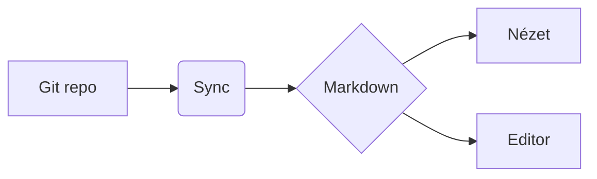

# Kódok

```bash
#!/bin/bash
# Telepítés és indítás
export KUBECONFIG=~/.kube/config
FOO=bar kubectl get pods -n kube-system | grep -v Running && helm upgrade --install app ./chart
docker run --rm \
  -v "$PWD:/data" -e TZ=Europe/Budapest \
  nginx:latest
if [ -f /etc/hosts ]; then ./deploy.sh --dry-run; fi
for f in *.md; do wc -l "$f"; done
result=$(terraform output -raw ip)
sudo systemctl restart nginx   # újraindítás
echo "Kész: ${result} ($HOME)" 2>&1
```

```yaml
server:
  port: 8080
  enabled: true
  hosts: [a.local, "b.local"]   # lista
  nothing: null
```

```json
{"name": "teszt", "count": 3, "ok": true, "tags": ["a", null]}
```

```sql
SELECT u.id, COUNT(*) AS n FROM users u WHERE u.active = 1 AND u.name LIKE 'A%' GROUP BY u.id;
```

```python
@dataclass
class Szerver:
    def hello(self, name: str) -> str:
        return f"Szia {name}"  # komment
```

| Név | Port | Állapot |
|-----|-----:|---------|
| web | 8080 | fut |
| db  | 5432 | áll |

> Megjegyzés: ez egy idézet blokk `inline kóddal`.


